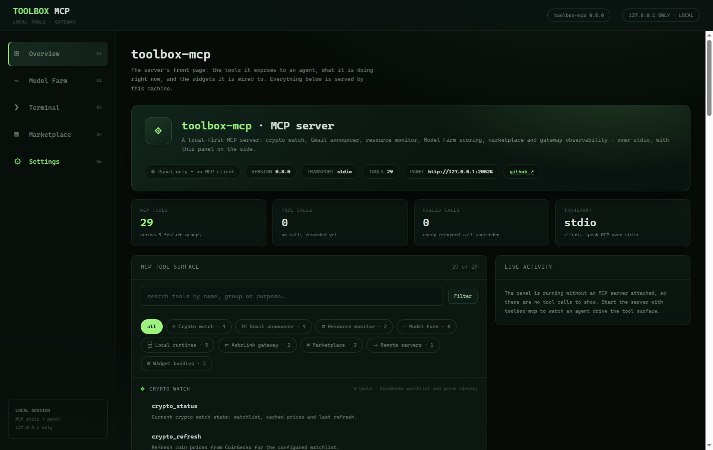
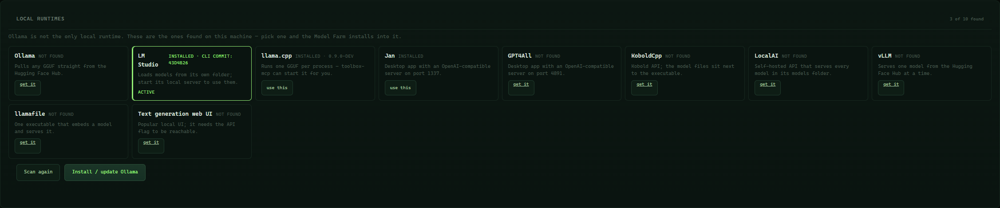

# toolbox-mcp

**Status:** `external_UAT` — released for acceptance testing outside the team. 

**Site:** <https://acsdd.github.io/toolbox-mcp/> — The project landing page.

Local-first MCP server that exposes the shared [Toolbox widgets](https://github.com/acsdd/toolbox-widgets) — **crypto watch**, **Gmail announcer** and **resource monitor** — to any MCP client, plus a small ops panel on `http://127.0.0.1:3851`.

Part of the Toolbox family:

| App | Repo |
| --- | --- |
| Toolbox (desktop) | [`toolbox-desktop`](https://github.com/acsdd/toolbox-desktop) |
| NAS companion | [`toolbox-nas`](https://github.com/acsdd/toolbox-nas) |
| Shared widget core | [`toolbox-widgets`](https://github.com/acsdd/toolbox-widgets) |

## Tools

| Tool | What it does |
| --- | --- |
| `crypto_status` / `crypto_refresh` / `crypto_set_watchlist` / `crypto_series` | CoinGecko watchlist and price history |
| `gmail_status` / `gmail_check` / `gmail_connect` / `gmail_disconnect` | Read-only Gmail IMAP checks (App Password, 16 chars) |
| `system_stats` / `system_processes` | CPU / memory / disk and top processes |
| `llamafarm_status` / `llamafarm_catalog` / `llamafarm_score` / `llamafarm_refresh` | Model Farm: HuggingFace catalog fit-scored against this machine; `status` also returns a 0–100 PC scorecard |
| `llamafarm_grade` | Rate this PC 0–100, and grade one model against it (weakest-link weighted) when a repo is given |
| `llamafarm_install` | Pull a catalog model into the local runtime (Ollama by default, or the runtime you picked) |
| `runtimes_detect` / `runtimes_install` / `runtimes_use` / `runtimes_models` / `runtimes_download` | Local model runtimes: find Ollama, LM Studio, llama.cpp, Jan, GPT4All, KoboldCpp, LocalAI, vLLM, llamafile and text-generation-webui, install Ollama, and choose which one the Model Farm installs into |
| `marketplace_list` / `marketplace_install` / `marketplace_uninstall` | Live module marketplace (public registry, installs via the bundle validator) |
| `remote_status` | Connected remote MCP servers and their tool counts |
| `gateway_status` / `gateway_requests` | Local AstrLink gateway: providers and subscription health, routing posture, capture/privacy settings, alerts, and recent call metadata (read-only, cached 30s) |
| `widgets_export` / `widgets_import` | Portable widget bundles (same format as Toolbox and the NAS app) |

## Ops panel

`http://127.0.0.1:3851` (override with `TOOLBOX_MCP_PORT`), localhost only.

The AstrLink Gateway section requires the AstrLink desktop and its agent tools
for this host. Install AstrLink, add local Ollama as a provider using the
[provider setup guide](https://docs.astrsk.ai/en/How-to-connect-providers),
then install the **AstrLink Gateway** feature from Marketplace. Model Farm
installs can also show the provider settings needed to connect each Ollama
model to AstrLink.

- **Overview** — the server's front page. A hero card states the identity of the
  running server (version, transport, panel URL, repo link), four stat tiles
  count the MCP tools, the recorded tool calls and the failures, and the
  **MCP tool surface** lists every tool the server exposes — grouped by
  feature (Crypto watch, Gmail announcer, Resource monitor, Model Farm,
  AstrLink gateway, Marketplace, Remote servers, Widget bundles), searchable
  by name or purpose and filterable by group, with each tool's parameter
  schema shown as chips. A **Live activity** feed on the right lists the tool
  calls as they land, with outcome and duration. The four shared widgets sit
  below as real UI: a price table, a mail list, resource meters and a widget
  bundle summary. The whole page is served by the server itself — nothing is
  fetched from the network.
- **Model Farm** — top HuggingFace models per skill (Text Generation, Text to Image,
  Text to Speech, …) as columns, color-marked against this machine:
  green = runs now, yellow = runs if you free resources, red = doesn't fit.
  Wave 1 detects the machine (RAM, cores, GPU VRAM, Ollama) and keeps the
  catalog to GGUF repos — every install goes through Ollama, which cannot pull
  safetensors checkpoints (an older mixed-format cache is dropped automatically).
  Wave 2 marks models live as
  you filter; wave 3 (Submit) returns the ordered verdict and keeps only reds
  that have an offload path — click a model for hints like `--n-gpu-layers`.
  A **PC scorecard** header rates this machine 0–100, every model row carries a
  **grade badge** (A+…F, weakest-link weighted), and expanding a model shows a
  digits-only PC-vs-model comparison with signed headroom and the weak-link
  sentence.
  The catalog is cached in `~/.toolbox-mcp/llamafarm-cache.json` for 6 hours.
  Expanding a model shows an **Install in &lt;runtime&gt;** action: the runtime is
  the one you picked under **Local runtimes** — Ollama by default. Ollama serves
  any GGUF straight from the Hub, so that install is a single `ollama pull
  hf.co/owner/repo:Q4_K_M` — with a GPU split it writes a Modelfile instead.
  A runtime that takes files instead of pulls gets the GGUF downloaded into its
  own models folder, and one that serves a single model per process (llama.cpp,
  llamafile) is started with it. If the runtime is missing, the action says so
  and prints the exact command to run.
  Successful installs show **Use in AstrLink** with a **Copy setup** button:
  OpenAI-compatible provider, default local base URL `http://127.0.0.1:11434/v1`,
  the installed model and `openai.chat`. Plain pulls use the full quantized
  `hf.co` reference; GPU-split installs use the created local model name.
  Follow AstrLink's [provider connection guide](https://docs.astrsk.ai/en/How-to-connect-providers)
  for adding the service, or see the [AstrLink project](https://github.com/Calcium-Ion/AstrLink).
  Adjust the address if Ollama runs elsewhere. These are manual service settings,
  not an import file: no credentials are included and nothing is configured in
  AstrLink automatically. Failed installs offer no setup. The same success-only
  settings are returned in the `astrlink` field of `llamafarm_install`.
- **Local runtimes** — Ollama is not the only local runtime. This card scans
  the machine for **Ollama, LM Studio, llama.cpp, Jan, GPT4All, KoboldCpp,
  LocalAI, vLLM, llamafile and text-generation-webui**, and reports each one
  as installed, running or missing. A runtime is found three ways: a server
  answering on its well-known port, its command line on `PATH`, and the
  program in its install folder — a leftover data folder alone does not count,
  so an app you uninstalled is not reported as present. When two runtimes share
  a port, the one that names itself in its banner wins and the other says
  which runtime holds the port. Pick one with **use this** and the Model Farm
  installs into that runtime from then on; the choice is stored in
  `~/.toolbox-mcp/settings.json`. **Install / update Ollama** downloads the
  official installer and runs it silently (per user, no administrator rights)
  so you end up with a fresh version rather than a stale one. Runtimes with
  their own installer get a **get it** link instead.
- **Terminal** — a local PowerShell session streamed to the browser. It runs
  with your user rights; the panel never binds beyond 127.0.0.1.
- **Marketplace** — VS Code-style storefront for shared Toolbox modules.
  The listing populates live from the public
  [`registry.json`](https://github.com/acsdd/toolbox-widgets/blob/main/registry.json)
  (cached 5 min) and search filters as you type. Installing a widget module
  applies its default settings through the portable bundle validator;
  uninstalling keeps your settings. The registry carries data only — never
  executable code. Overview shows cards for installed widgets only.
  **Remote-server modules** (e.g. LiquidVision crypto derivatives, cve.now
  vulnerability feed) connect over streamable HTTP and their tools appear
  here namespaced (`cve_now_list_feed`, `liquidvision_get_funding_rates`).
  Endpoints must be public HTTPS — loopback/private hosts are rejected.
  Remote modules are opt-in and badged: their tool arguments leave this
  machine. Installed remotes reconnect automatically on startup.
- **Gateway** — read-only observability for the local AstrLink API gateway:
  provider and subscription health, routing strategy and identity enforcement,
  capture/privacy posture, the alerts that follow, and a filterable page of
  recent calls with token and latency totals. It runs the gateway's own observer
  CLI, so it never changes a setting and never reads a prompt or response body.
  The section appears once the `astrlink-gateway` module is installed from the
  Marketplace; if the gateway is stopped, not installed or unreachable, it says
  which instead of failing. For a local development build, the new module will
  not appear in the live Marketplace until `toolbox-widgets/registry.json` is
  published to that repository's default branch; rebuilding this server alone
  does not publish the registry.
- **Settings** — edit the preferences the panel stores in
  `~/.toolbox-mcp/settings.json`: the crypto watchlist, the disk the resource
  monitor reports on, whether the process list is shown, and the local runtime
  the Model Farm installs into. Nothing is
  uploaded. The terminal command history is kept in the browser's local
  storage, so it survives a page reload but never leaves the browser.






## Run

Requires Node.js 22+. The sibling `toolbox-widgets` repo must be checked out next to this one.

For the complete Windows setup—including Ollama, AstrLink and MCP client
configuration—see [Set up Toolbox MCP with AstrLink](docs/astrlink-setup.md).

```bash
git clone https://github.com/acsdd/toolbox-widgets.git
git clone https://github.com/acsdd/toolbox-mcp.git
cd toolbox-mcp
npm ci
npm start          # MCP server on stdio + ops panel on 127.0.0.1:3851
```

Settings live in `~/.toolbox-mcp/settings.json` (override with `TOOLBOX_MCP_HOME`).
The file is owner-readable only (`0600`). **Note:** the Gmail App Password is stored
there in plain text until OS keychain integration lands — keep the file safe, and
never commit it. Nothing else you keep in that file is sent anywhere.

## Development

```bash
npm test           # build + node:test suite
npm run typecheck
```

## Security

- The server binds to `127.0.0.1` only — it is never reachable from the network.
- The ops panel answers only requests that come from this machine: a foreign
  `Host` header (DNS rebinding) or a foreign `Origin` (a web page driving the
  panel) is refused with `403`.
- The panel page loads nothing from the network and runs under a strict content
  security policy; request bodies are capped at 1 MB.
- Credentials live in `~/.toolbox-mcp/settings.json` (`0600`), never in the
  repository. The Gmail App Password is stored in plain text there until OS
  keychain integration lands.
- Remote marketplace modules are opt-in and badged: their tool arguments leave
  this machine.

## Release

This repo ships two things: the MCP server itself (used from a checkout) and
the **Model Farm** portable app — `dist/ModelFarm-Portable-<version>.exe` —
which bundles the ops panel and the widget core into one Windows executable.

### Build the portable app

The portable build borrows the Electron toolchain from the sibling desktop
checkout (`../toolbox-desktop`, the `toolbox-desktop` repo), so that checkout has to be
present with its dependencies installed.

```bash
npm install
npm run portable      # → dist/ModelFarm-Portable-0.8.0.exe
```

Smoke-test the packaged app before shipping it — point the script at the
packaged `app.asar`:

```bash
../toolbox-desktop/node_modules/.bin/electron scripts/smoke-portable.cjs \
  <unpacked-app>/resources/app.asar
```

### Publish order

The widget core is a `file:` dependency and the Marketplace registry lives in
the widget core repo, so **the widget core has to be published first**:

1. **`toolbox-widgets`** — push `main`. That publishes the new registry entry,
   so the module shows up in the live Marketplace, and it gives this repo's CI
   the widget core it builds against.
2. **`toolbox-mcp`** — push `main`, then tag and release:

```bash
npm run release:notes -- --to HEAD --out release-notes.md
git tag v0.8.0
git push origin main --tags
gh release create v0.8.0 dist/ModelFarm-Portable-0.8.0.exe \
  --title "Model Farm 0.8.0" --notes-file release-notes.md
```

No credential ever lands in this repository: the Gmail App Password is written
to `~/.toolbox-mcp/settings.json` on your machine only. The release artifact
contains code, not your settings.

## License

MIT — see [LICENSE](LICENSE).
