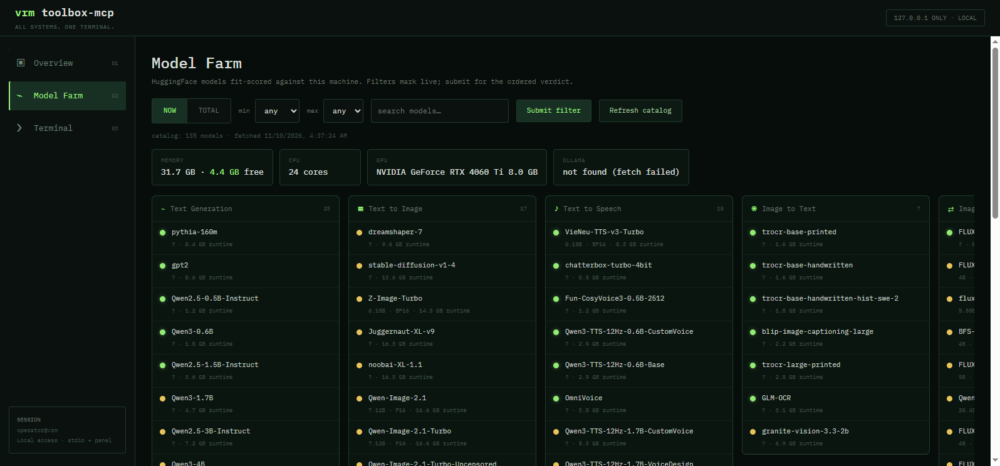

# toolbox-mcp

Private, local-first MCP server that exposes the shared [Toolbox widgets](https://github.com/acsdd/toolbox-widgets) — **crypto watch**, **Gmail announcer** and **resource monitor** — to any MCP client, plus a small ops panel on `http://127.0.0.1:3851`.

Part of the Toolbox family:

| App | Repo |
| --- | --- |
| Toolbox (desktop) | [`toolbox-desktop`](https://github.com/28121978444/toolbox-desktop) |
| NAS companion | [`toolbox-nas`](https://github.com/28121978444/toolbox-nas) |
| Shared widget core | [`toolbox-widgets`](https://github.com/acsdd/toolbox-widgets) |

## Tools

| Tool | What it does |
| --- | --- |
| `crypto_status` / `crypto_refresh` / `crypto_set_watchlist` / `crypto_series` | CoinGecko watchlist and price history |
| `gmail_status` / `gmail_check` / `gmail_connect` / `gmail_disconnect` | Read-only Gmail IMAP checks (App Password, 16 chars) |
| `system_stats` / `system_processes` | CPU / memory / disk and top processes |
| `llamafarm_status` / `llamafarm_catalog` / `llamafarm_score` / `llamafarm_refresh` | Model Farm: HuggingFace catalog fit-scored against this machine; `status` also returns a 0–100 PC scorecard |
| `llamafarm_grade` | Rate this PC 0–100, and grade one model against it (weakest-link weighted) when a repo is given |
| `llamafarm_install` | Pull a catalog model into the local Ollama runtime (optional GPU split) |
| `marketplace_list` / `marketplace_install` / `marketplace_uninstall` | Live module marketplace (public registry, installs via the bundle validator) |
| `remote_status` | Connected remote MCP servers and their tool counts |
| `gateway_status` / `gateway_requests` | Local AstrLink gateway: providers and subscription health, routing posture, capture/privacy settings, alerts, and recent call metadata (read-only, cached 30s) |
| `widgets_export` / `widgets_import` | Portable widget bundles (same format as Toolbox and the NAS app) |

## Ops panel

`http://127.0.0.1:3851` (override with `TOOLBOX_MCP_PORT`), localhost only.

- **Overview** — the shared widgets, live.
- **Model Farm** — top HuggingFace models per skill (Text Generation, Text to Image,
  Text to Speech, …) as columns, color-marked against this machine:
  green = runs now, yellow = runs if you free resources, red = doesn't fit.
  Wave 1 detects the machine (RAM, cores, GPU VRAM, Ollama) and keeps the
  catalog to GGUF repos — every install goes through Ollama, which cannot pull
  safetensors checkpoints (an older mixed-format cache is dropped automatically).
  Wave 2 marks models live as
  you filter; wave 3 (Submit) returns the ordered verdict and keeps only reds
  that have an offload path — click a model for hints like `--n-gpu-layers`.
  A **PC scorecard** header rates this machine 0–100, every model row carries a
  **grade badge** (A+…F, weakest-link weighted), and expanding a model shows a
  digits-only PC-vs-model comparison with signed headroom and the weak-link
  sentence.
  The catalog is cached in `~/.toolbox-mcp/llamafarm-cache.json` for 6 hours.
  Expanding a model shows an **Install in Ollama** action: Ollama serves any
  GGUF straight from the Hub, so the install is a single `ollama pull
  hf.co/owner/repo:Q4_K_M` — with a GPU split it writes a Modelfile instead.
  If Ollama is missing, the action says so and prints the exact command to run.
  Successful installs show **Use in AstrLink** with a **Copy setup** button:
  OpenAI-compatible provider, default local base URL `http://127.0.0.1:11434/v1`,
  the installed model and `openai.chat`. Plain pulls use the full quantized
  `hf.co` reference; GPU-split installs use the created local model name.
  Adjust the address if Ollama runs elsewhere. These are manual service settings,
  not an import file: no credentials are included and nothing is configured in
  AstrLink automatically. Failed installs offer no setup. The same success-only
  settings are returned in the `astrlink` field of `llamafarm_install`.
- **Terminal** — a local PowerShell session streamed to the browser. It runs
  with your user rights; the panel never binds beyond 127.0.0.1.
- **Marketplace** — VS Code-style storefront for shared Toolbox modules.
  The listing populates live from the public
  [`registry.json`](https://github.com/acsdd/toolbox-widgets/blob/main/registry.json)
  (cached 5 min) and search filters as you type. Installing a widget module
  applies its default settings through the portable bundle validator;
  uninstalling keeps your settings. The registry carries data only — never
  executable code. Overview shows cards for installed widgets only.
  **Remote-server modules** (e.g. LiquidVision crypto derivatives, cve.now
  vulnerability feed) connect over streamable HTTP and their tools appear
  here namespaced (`cve_now_list_feed`, `liquidvision_get_funding_rates`).
  Endpoints must be public HTTPS — loopback/private hosts are rejected.
  Remote modules are opt-in and badged: their tool arguments leave this
  machine. Installed remotes reconnect automatically on startup.
- **Gateway** — read-only observability for the local AstrLink API gateway:
  provider and subscription health, routing strategy and identity enforcement,
  capture/privacy posture, the alerts that follow, and a filterable page of
  recent calls with token and latency totals. It runs the gateway's own observer
  CLI, so it never changes a setting and never reads a prompt or response body.
  The section appears once the `astrlink-gateway` module is installed from the
  Marketplace; if the gateway is stopped, not installed or unreachable, it says
  which instead of failing. For a local development build, the new module will
  not appear in the live Marketplace until `toolbox-widgets/registry.json` is
  published to that repository's default branch; rebuilding this server alone
  does not publish the registry.



## Run

Requires Node.js 22+. The sibling `toolbox-widgets` repo must be checked out next to this one.

```bash
npm install
npm start          # MCP server on stdio + ops panel on 127.0.0.1:3851
```

Settings live in `~/.toolbox-mcp/settings.json` (override with `TOOLBOX_MCP_HOME`).
The file is owner-readable only (`0600`). **Note:** the Gmail App Password is stored
there until OS keychain integration lands — keep the repo private and the file safe.

## Development

```bash
npm test           # build + node:test suite
npm run typecheck
```

## Release

This repo ships two things: the MCP server itself (used from a checkout) and
the **Model Farm** portable app — `dist/ModelFarm-Portable-<version>.exe` —
which bundles the ops panel and the widget core into one Windows executable.

### Build the portable app

The portable build borrows the Electron toolchain from the sibling desktop
checkout (`../quoder`, the `toolbox-desktop` repo), so that checkout has to be
present with its dependencies installed.

```bash
npm install
npm run portable      # → dist/ModelFarm-Portable-0.6.0.exe
```

Smoke-test the packaged app before shipping it — point the script at the
packaged `app.asar`:

```bash
../quoder/node_modules/.bin/electron scripts/smoke-portable.cjs \
  <unpacked-app>/resources/app.asar
```

### Publish order

The widget core is a `file:` dependency and the Marketplace registry lives in
the widget core repo, so **the widget core has to be published first**:

1. **`toolbox-widgets`** — push `main`. That publishes the new registry entry,
   so the module shows up in the live Marketplace, and it gives this repo's CI
   the widget core it builds against.
2. **`toolbox-mcp`** — push `main`, then tag and release:

```bash
npm run release:notes -- --to HEAD --out release-notes.md
git tag v0.6.0
git push origin main --tags
gh release create v0.6.0 dist/ModelFarm-Portable-0.6.0.exe \
  --title "Model Farm 0.6.0" --notes-file release-notes.md
```

This repository is private — the Gmail App Password is written to
`~/.toolbox-mcp/settings.json` — so a release is only visible to the people
who already have access to the repository.

## License

MIT — see [LICENSE](LICENSE).
